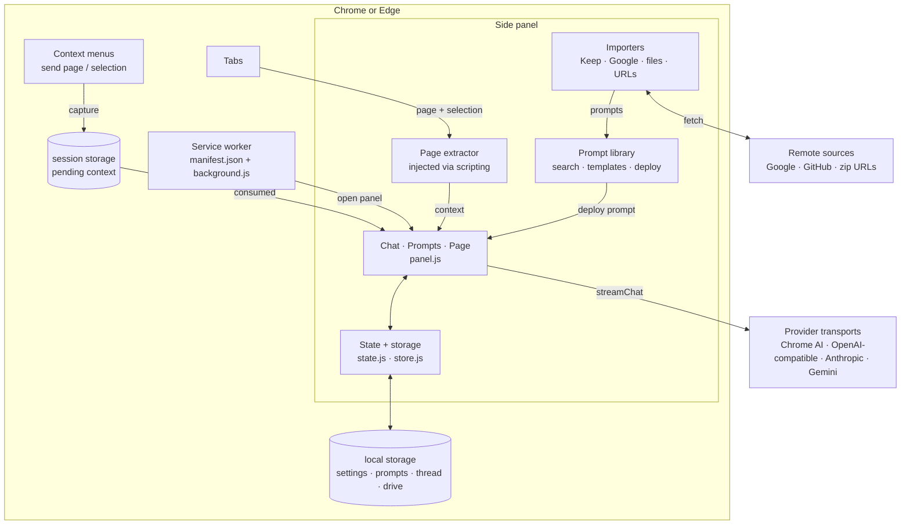
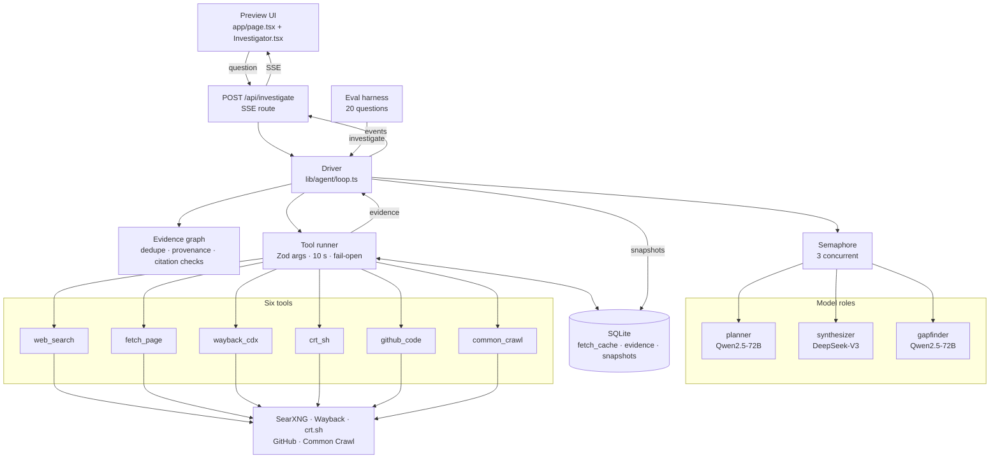

# LLM Side Panel — architecture, behavior, and history

*Written 15 November 2026. Describes version 0.3.0 of the extension and the investigation agent as they exist in this workspace.*

Two Mermaid diagrams below give the module-level view: one for the extension and one for the agent. The prose that follows explains each box.

## 1. What this repository is

Two products in one repository, sharing one `package.json` and one README:

1. **A Manifest V3 browser side panel** — a zero-build, dependency-free extension that talks to any LLM, reads the page you are on, and manages a large prompt library imported from Google Keep, Google Docs/Drive, files, and remote skill collections.
2. **An evidence-first investigation agent** — a Next.js 16 application with an SSE endpoint, six retrieval tools, a SQLite cache, Wayback snapshots, and a 20-question eval harness.

They are deliberately separate runtimes. The extension runs entirely inside Chrome; the agent needs Node 22.5+, a filesystem, `node:sqlite`, and outbound HTTP. The extension does not call the agent, and the agent does not serve the extension. The only coupling is the repository and the shared prompt-splitting philosophy.

The extension is the mature half: 17 JavaScript files, a side panel, a settings drawer, a prompt library, and 38 Node checks. The agent is the newer half: 39 TypeScript files, a browser page for previewing it, 14 tests, and a build that produces one dynamic route. All of it is currently **uncommitted** on branch `freebuff/13873a24130eb422c027bead`; `README.md` is modified and the rest is untracked.

## 2. Design principles

- **Free by default.** The first-run chooser offers Chrome's on-device model (no key, no network), local Ollama/LM Studio, or a free-tier key. Nothing is gated, metered, or account-bound; the code is MIT.
- **No build step for the extension.** Every file is plain ES module JavaScript loaded directly by Chrome. There is no bundler, transpiler, package dependency, or supply chain to audit. The Next app is the exception and has its own dependencies.
- **Local-first.** Keys, prompts, chat history, and Drive tokens live in `chrome.storage.local`. Imported documents are parsed in the panel. There is no backend and no telemetry. The only network calls are the ones the user's chosen provider and import URLs require.
- **Evidence before prose (agent).** A model may cite only evidence that exists in a graph, with a verbatim quote. Anything the agent cannot establish is returned in a required `gaps` field.
- **Fail open, report honestly.** Tools time out or fail into an empty array plus a gap; a failed import reports what failed rather than pretending partial success.
- **Small files, typed boundaries.** The extension uses pure modules for parsers and splitters so Node can test them. The agent uses Zod at every model, HTTP, and tool boundary.

## 3. Repository map

```
manifest.json               MV3 manifest: side panel, permissions, host access
background.js               service worker: panel behaviour, context menus, handoff
src/sidepanel/              panel.html, panel.css, panel.js, state.js, library.js, ui.js
src/lib/                    providers, Chrome AI, page extraction, prompt engine, storage
src/lib/import/             zip, HTML, Keep, Google Docs/Drive, files, remote collections
src/prompts/builtin.js      starter pack (35 prompts)
tests/run.mjs               dependency-free Node checks for the pure extension logic
app/                        Next.js App Router: layout, agent page, SSE route
app/components/             client Investigator component
lib/agent/                  driver loop, prompts, Zod schemas
lib/evidence/               evidence factory and graph
lib/tools/                  one file per tool + runner + registry
lib/fetch/                  SearXNG, Wayback, crt.sh, GitHub, Common Crawl, HTML extraction
lib/cache/                  SQLite schema, fetch cache, tests
eval/                       20 questions, scorer, live runner
AGENT.md                    agent-specific documentation
README.md                   extension user guide
```

## 4. The browser extension

### The shape of the extension



The panel is the runtime: the service worker only wires the action and context menus, and everything else happens while the panel is open. Imports are parsed locally and written through the same deduplicating store as manual prompts; only remote collection URLs and Google requests leave the machine. Chat traffic goes directly to the selected provider.

### 4.1 Packaging and lifecycle

`manifest.json` declares MV3, minimum Chrome/Edge 116 (the side panel API), a module service worker, and the side panel path `src/sidepanel/panel.html`. Permissions are `sidePanel`, `storage`, `unlimitedStorage`, `scripting`, `activeTab`, `tabs`, `contextMenus`, `clipboardWrite`, and `identity`; `host_permissions` is `<all_urls>`, needed both to read arbitrary pages and to reach any OpenAI-compatible endpoint.

`background.js` is intentionally thin. On install it sets `openPanelOnActionClick`, rebuilds two context menus (*Send selection to LLM panel*, *Send this page to LLM panel*), and on click writes a payload (`kind`, `text`, `title`, `url`, `ts`) to `chrome.storage.session`, opens the panel for that tab (the click counts as the required user gesture), and sends a `pending-context` message. The panel consumes and clears the payload on boot or on message. This survives the service worker being torn down.

All application logic lives in the panel, which exists only while open. There is no offscreen document, no content script, and no persistent background state beyond storage.

### 4.2 UI and state

`panel.html` is a three-tab shell — **Chat**, **Prompts**, **Page** — plus a model pill, a settings drawer, a modal root, a toast, and a drawer backdrop. The drawer holds provider, model, API key, base URL (custom only), temperature, system prompt, page-context limit, free-options chooser, Google OAuth client, library actions, and chat clearing.

`state.js` holds one mutable object: settings, prompts, messages, captured context, active tab, streaming flag, abort controller, library filters, and an 80-item render limit. `bootstrap()` loads storage, and on first run seeds the starter pack if the library is empty, then marks `starterLoaded`. Everything renders by replacing `innerHTML` fragments built with an `esc()` helper.

Storage lives under `llmsp.v2.` keys: `settings`, `prompts`, `thread`, `drive`, plus the session-only `pendingContext`. Defaults are the on-device provider (`builtin`, `gemini-nano`), temperature 0.7, 2048 max tokens, a 24,000-character context limit, and a system prompt that tells the model to ground answers in attached page context.

### 4.3 Chat pipeline and providers

`src/lib/providers.js` is a registry of 15 providers:

| Provider | Kind | Notes |
| --- | --- | --- |
| Chrome built-in AI | `chrome-ai` | Gemini Nano on-device, free, no key |
| OpenAI | OpenAI-compatible | `gpt-5`, `gpt-5-mini`, `gpt-4.1`, `gpt-4o`, `o4-mini` |
| Anthropic Claude | native Messages | Browser-access header required by Anthropic |
| Google Gemini | native `generateContent` | Streams via `alt=sse` |
| Mistral, Groq, DeepSeek, xAI, Together, Perplexity, Cerebras | OpenAI-compatible | Free-tier labels where applicable |
| OpenRouter | OpenAI-compatible | Hundreds of models, some `:free` |
| Ollama, LM Studio | OpenAI-compatible, local | No key; localhost defaults |
| Custom | OpenAI-compatible | Editable base URL |

`providerConfig()` resolves base URL, model, key, and readiness. `streamChat()` trims history to the last 20 messages and dispatches to one of four transports: the Chrome AI session, Anthropic's `/messages`, Gemini's `streamGenerateContent`, or `<base>/chat/completions`. OpenAI-style and Gemini responses are parsed as SSE (`event:`/`data:` lines, `[DONE]`), with a non-streaming JSON fallback. Errors include the provider's status and message. OpenRouter gets `HTTP-Referer` and `X-Title` headers.

Chrome's built-in model is the free path. `src/lib/chrome-ai.js` probes both `LanguageModel` and the legacy `ai.languageModel`, maps `availability()`/`capabilities()` into available/downloadable/downloading/unavailable, and reports download progress. It creates a session with a system prompt and the last six history turns, streams `promptStreaming`, and handles both current delta chunks and older cumulative chunks. Aborting destroys the session. The model is downloaded by Chrome on first use; the panel caps page context at 8,000 characters for this provider because its window is small.

Message construction is context-aware. Only the **most recent** user message that carries context gets a `<page_context url="…" title="…">` block, so a long conversation does not resend the same page on every turn. Streaming paints through `requestAnimationFrame`, shows a typing indicator, and supports Stop (abort), Retry (rewinds to the preceding user message), Copy, and Delete. The thread is persisted (last 80 messages).

Markdown rendering is a small hand-written renderer in `ui.js`: fenced code blocks, headings, ordered/unordered lists, blockquotes, horizontal rules, inline code, bold/italic, links, and autolinked URLs. It escapes first, so model output cannot inject HTML.

### 4.4 Page capture and extraction

Capture uses `chrome.scripting.executeScript` with `extractPageContext`, a self-contained function serialized into the page. It refuses browser-internal schemes (`chrome:`, `edge:`, `about:`, `devtools:`, extension pages, Web Store, etc.).

Inside the page it removes scripts, styles, navigation, footers, asides, forms, buttons, dialogs, iframes, media, and hidden/aria-hidden nodes. It scores candidate roots (`article`, `main`, `[role=main]`, article-body classes, `#content`) by `innerText` length plus a 500-point bonus for `<article>`; if the best is under 400 characters it falls back to `document.body`. Tables become `<pre>` blocks of pipe-joined rows. Serialization converts headings (level +1, capped at 6), lists, code, blockquotes, images (alt text), and horizontal rules into a markdown-ish text, capped at 120,000 characters.

The returned object includes title, URL, description, site name, author, language, word count, headings (40), links (40), image alt text (20), the current selection, truncation flag, and timestamp. The panel shows a context chip and a preview; context applies to the next message only. A page can also be captured from the Page tab's list of other open tabs, and a selection can arrive from the context menu.

Known blockages are explicit: PDFs, `chrome://` pages, the Web Store, and `file://` URLs without file access cannot be injected; the panel tells the user to select text and use Capture selection.

### 4.5 Prompt library

Each prompt is normalized to `{id, title, body, tags, collection, source{kind,label,ref,url}, fingerprint, pinned, uses, createdAt, updatedAt, lastUsedAt}`. Titles cap at 200 characters, tags at 24, collections at 120. The fingerprint is a djb2 hash over normalized title + body; `addPrompts` skips duplicates by fingerprint and reports `added`/`skipped`. `unlimitedStorage` means tens of thousands of prompts are viable, though the list renders 80 at a time.

Search is a weighted score: exact title 200, title prefix 80, title substring 50, tag 35, collection 20, body 15; each query token adds 12/8/3 by title/tag/body; pinned adds 25 and uses up to 20. Sort modes are relevance, recent, title, and most used. Facets drive collection and tag chips plus a source filter.

Deploying a prompt extracts `{{variables}}`. Built-ins (`page`, `page_title`, `page_url`, `page_description`, `selection`, `date`, `time`) are filled from the captured context; any other placeholder produces a form field, using a textarea for long or page-like values. Empty values remain visible as `{{placeholder}}` rather than becoming blank. Deploy inserts into the composer; Run sends immediately; both increment `uses` and `lastUsedAt`.

The starter pack has **35** prompts across Page & research (8), Writing (8), Coding (7), Business (5), Study (4), and Utility (3). It seeds only when the library is empty.

### 4.6 Importers

All importers are pure parsers where possible, so they run in the panel, in Node tests, and without dependencies.

**Google Keep.** There is no consumer Keep API (the Workspace API needs domain-wide delegation), so the supported route is Google Takeout's HTML export. `importKeepTakeoutZip` reads entries under `Keep/*.html` with the built-in zip reader, extracts `.title`, `.text-content`, list content, labels, and the archived flag, skips archived notes, and produces one prompt per note. Loose HTML files and Keep-shaped JSON (`{title, body:{text:{text}}, labels}`) are also accepted. Errors distinguish "no Keep folder" from "Keep folder with no readable HTML".

**Google Docs and Drive.** Two paths:

- *Link import* uses the browser's Google session (`credentials: 'include'`) against `docs.google.com/document/d/<id>/export?format=txt`, `spreadsheets/d/<id>/export?format=csv`, and `drive.google.com/uc?export=download&id=…`. It detects sign-in pages and refuses to import a login form, checks that Drive files are text-like, and caps a batch at 20 links. Each document is split by structure.
- *Drive OAuth* is optional: the user creates a Web application OAuth client, adds the extension's `chrome.identity.getRedirectURL()` as a redirect URI, and pastes the client ID into Settings. The implicit flow requests `drive.readonly`; the access token is cached until expiry minus a minute. Listing queries non-trashed Docs, plain text, markdown, and JSON, ordered by modification time; Docs export as `text/plain`, other files download via `alt=media`.

**Files.** `.md`/`.markdown`/`.txt` route through the splitter, `.csv`/`.tsv` through a header-aware CSV parser (aliases for title/body/tags/collection), `.json` through array/`{prompts}`/`{items}` shapes, `.html` through Keep-note detection then text extraction, and `.zip` first through the Keep importer then through the markdown/skills importer. `SKILL.md` (YAML-ish frontmatter with `name`/`description`, body) becomes a prompt titled by `name`, tagged `skill`, with `allowed-tools` adding a `tools` tag. Frontmatter is parsed with a line regex, not a YAML dependency.

**Remote collections (Skills URL).** Added last, and the only importer that fetches from the network before parsing:

- GitHub repository URLs (`/tree/<branch>/<folder>` narrows scope; `/blob/` imports one markdown file) use the public API: repo metadata for the default branch, then a recursive tree, then raw file downloads with six-way concurrency.
- If the repository contains any `SKILL.md`, only those are imported; otherwise every non-documentation markdown file is split by headings.
- If GitHub answers 403/429 (the public API allows 60 requests/hour per address), the importer automatically downloads the repository archive (`/archive/<ref>.zip`, `HEAD` when no ref is given) and parses it locally. A real run against a rate-limited address produced 11 prompts from 2 files in about 700 ms this way.
- Zip URLs and raw markdown URLs are fetched directly. A zip must actually be a zip (signature check) and is read with the same zero-dependency reader.
- Limits: 200 files per collection, 400,000 characters per file, 20 s per request, 60 s per zip. Unreadable files are counted, not fatal. Nothing is added until the preview checklist is confirmed; the user can untick items or select none.

**Splitting.** `splitPrompts` supports `auto`, `single`, `heading`, `numbered`, `delimiter`, and `bullets`. Auto tries, in order: markdown headings at the smallest level used at least twice; numbered items (three or more, or two explicit `Prompt N:` labels, with an average body length check); lines of `---`/`***`/`===`; and bullets (three or more, each at least 40 characters). If none yields two prompts, the whole text becomes one. Sections shorter than 8 characters are dropped. The same engine handles Keep notes, Docs, files, and remote collections.

**Export.** All prompts can be exported as JSON (`title`, `body`, `tags`, `collection`, metadata stripped) or markdown; a single prompt can be downloaded as `.md`. Imports are fingerprinted, so re-importing the same material reports duplicates instead of piling up.

### 4.7 Privacy and security posture

- API keys and Drive tokens are stored in plain text in `chrome.storage.local`; the UI says so and offers **Forget saved key**.
- Chat requests go directly from the extension to the chosen provider. There is no intermediary, no analytics, and no telemetry.
- With Chrome's built-in model, page text and messages never leave the machine.
- Page text is sent only when the user sends a message with context attached (and only on that message).
- `<all_urls>` host access is broad by design: it is what allows reading arbitrary pages and calling arbitrary compatible endpoints. It can be narrowed for a fixed provider set.
- Model output is escaped before rendering; imports are parsed locally.

## 5. The investigation agent

### The shape of the agent



The loop owns the sequence and the graph; tools never touch the model, and the model never touches a source directly. Tool results are normalized into evidence before entering the graph, every model call passes through the shared semaphore, and the same `investigate()` entry point serves both the HTTP route and the eval runner. Cache reads/writes are best effort and never fail a run.

### 5.1 Why a separate runtime

The agent is a Next.js 16 App Router project. It uses `node:sqlite` (Node 22.5+), a long-lived process for its semaphore, filesystem caching, outbound fetches without browser CORS constraints, and SSE. None of that maps cleanly onto an MV3 service worker or panel. It is therefore a second deliverable, documented separately in `AGENT.md`, rather than a feature of the extension.

### 5.2 Evidence contract and graph

Every tool returns `Evidence[]`, and each item is built by `makeEvidence`:

```ts
{ id, url, fetched_at, sha256, source_tool, extractor_version, text }
```

`id` is deterministic: `ev_` plus a short hash of canonical URL + SHA-256 of the text. Text is trimmed and capped at 12,000 characters (`EVIDENCE_MAX_CHARS`). Empty URL or text yields `null`, so nothing unciteable enters. `extractor_version` is `html-text-v1` for page extraction.

`EvidenceGraph` enriches nodes with canonical URL, 64-bit simhash, confidence, provenance, and an optional snapshot URL. Dedupe is canonical URL first (merging provenance and raising confidence), then simhash Hamming distance ≤ 6 (configurable via `SIMHASH_DISTANCE`). Initial confidence is per source: page 0.75, GitHub code 0.65, Wayback 0.6, crt.sh 0.55, Common Crawl 0.5, web search 0.4.

Citation validation is strict: the ID must exist; the quote must be at least 12 characters after normalization and must be a substring of that evidence's text; exact duplicate quotes for the same source are rejected. Multiple distinct quotes from one source are allowed. Invalid citations are removed, the synthesis is retried once with the validator's complaints, and any remaining invalidity becomes a `citation integrity` gap. Co-cited nodes get `supports` edges.

### 5.3 The loop

`investigate()` in `lib/agent/loop.ts` is the driver, capped at 12 tool calls and 4 fetched pages:

1. **Plan** — the planner role returns 2–4 checkable queries as JSON. Failure falls back to the raw question and records a `query planning` gap.
2. **Search** — one web search per query via SearXNG.
3. **Structured sources** — domains found in the queries (max 2) trigger Wayback CDX, Common Crawl, and crt.sh in parallel. Technical queries (code/repo/API/CVE/etc.) also trigger GitHub code search.
4. **Read** — up to 4 unique HTTP(S) result URLs are fetched and extracted to full text.
5. **No evidence** — if the graph is empty, the agent returns a zero-confidence "No evidence could be retrieved" result with gaps and never calls the synthesizer.
6. **Synthesise** — the model returns `{answer, citations, gaps, confidence}` against only the evidence list.
7. **Validate/retry** — as above.
8. **Gap review** — the gapfinder role adds missing angles; deterministic gaps (tool failures, timeouts, no evidence, invalid citations) are already present.
9. **Snapshot** — page evidence starts a Wayback save as soon as it is added (outside the tool deadline, awaited before the result); other cited URLs are snapshotted after validation. Failures become `archival snapshot` gaps.
10. **Emit** — `result` then `done`.

Final confidence is the average of the model's self-report and the graph's mean, clamped to 0–1. Gaps are deduplicated by normalized topic.

### 5.4 Tools and sources

One tool per file, each with Zod-typed args and a 10-second deadline enforced by `runTool`, which validates args, catches failures, and returns an empty array plus a gap instead of throwing.

| Tool | Input | Source |
| --- | --- | --- |
| `web_search` | query | SearXNG JSON (`format=json`, safesearch=1) |
| `wayback_cdx` | target | Wayback CDX, status 200, collapse by digest, limit 5 |
| `crt_sh` | domain | certificate transparency JSON |
| `github_code` | query | GitHub code search (needs `GITHUB_TOKEN`) |
| `common_crawl` | target | Common Crawl index (latest collection resolved via `collinfo.json`) |
| `fetch_page` | URL | cached fetch + readable-text extraction, 12k cap |

Every fetch goes through `getOrFetch`, which caches in SQLite keyed by URL and UTC day, so a rerun on the same day reuses responses. Wayback saves are cached per URL in a `snapshots` table so repeated investigations do not hammer the save endpoint.

### 5.5 Storage

`data/cache.sqlite` (override with `CACHE_DB=:memory:` for tests) runs in WAL mode with:

- `fetch_cache(url, day, status, content_type, body, fetched_at, final_url)` — primary key `(url, day)`.
- `evidence(id, url, canonical_url, fetched_at, sha256, source_tool, extractor_version, text, simhash, confidence, snapshot_url)`.
- `snapshots(url, snapshot_url, attempted_at, ok)`.

Cache writes are best effort; a failed cache write never fails an investigation.

### 5.6 Models and concurrency

`lib/llm.ts` talks to Featherless (OpenAI-compatible), overridable with `FEATHERLESS_BASE_URL`. Only the key is required. Per-role configuration:

| Role | Default model | Temperature | Max tokens | Timeout |
| --- | --- | --- | --- | --- |
| planner | `Qwen/Qwen2.5-72B-Instruct` | 0.2 | 700 | 60 s |
| synthesizer | `deepseek-ai/DeepSeek-V3-0324` | 0.1 | 1800 | 90 s |
| gapfinder | `Qwen/Qwen2.5-72B-Instruct` | 0.3 | 700 | 60 s |

Models are overridable with `ROLE_PLANNER_MODEL`, `ROLE_SYNTH_MODEL`, and `ROLE_GAP_MODEL`. Requests retry up to three times on 429/5xx with exponential backoff, then fail. Every call passes through a process-wide semaphore with a default limit of 3 (`LLM_MAX_CONCURRENCY`). Model output is parsed loosely (fenced JSON or brace extraction) and validated with Zod, with one corrective retry that includes the validator's complaint. A missing key raises `LlmUnavailableError`; the route still runs tools and returns a truthful no-evidence result.

### 5.7 HTTP API

`POST /api/investigate` accepts `{question}` (3–2000 characters) and returns `text/event-stream`. Events: `status`, `plan`, `evidence`, `gap`, `result`, `error`, `done`. Invalid bodies return HTTP 400 with Zod issues. The route is `runtime = "nodejs"`, `force-dynamic`, and `maxDuration = 300`. The client abort signal is passed into the loop, and the stream closes in `finally`. There is **no authentication or rate limiting**; it is meant to sit behind the operator's own auth.

### 5.8 The preview page

`app/page.tsx` plus `app/components/Investigator.tsx` is a minimal client that POSTs the question and parses SSE frames by hand. It shows live status, the plan's queries, evidence as it arrives (tool badge, host, expandable text, links), gaps, and the final answer with quote citations, source links, Wayback snapshot links, confidence, counts, and duration. Stop aborts the fetch. It uses no markdown library and no extra dependencies. This page exists so the agent can be seen; it is not part of the extension.

### 5.9 Eval harness

The harness was built before any UI. `eval/questions.ts` holds 20 questions with a known-good answer, answer keywords, expected domains, and expected gap topics. The mix is deliberate: stable factual questions (HTTP 418/RFC 2324, Rust 1.0, SQLite license, curl's maintainer, HTTP/3), plus time-varying or non-public ones (USPS stamp price, OpenAI CEO/headcount, Node LTS, OpenSSL 2024 CVEs, Common Crawl size, NYT traffic, UK grid mix, live DNS, GitHub stars, Wayback coverage, OpenClaw license, Claude pricing, Tokyo population). Gap recall only has signal when the agent admits what it cannot know.

Scoring is **0.6 × citation validity + 0.4 × gap recall**. Citation validity checks that cited IDs exist, quotes are verbatim, and there are no duplicates. Gap recall matches an expected gap topic by phrase or ≥60% token overlap. Answer keywords and expected domains are diagnostics only and do not affect the score.

`eval/run.ts` runs live investigations, writes `eval/results/<timestamp>.json`, supports `--limit`, `--verbose`, and `--dry-run`, and fails below `EVAL_MIN_COMPOSITE` when set. The dry run validates all 20 definitions without keys or network.

## 6. Verification ledger

What has actually been run:

- `npx tsc --noEmit` passes.
- `npx next build` succeeds; the route output is `ƒ /api/investigate`.
- 14 agent tests pass: citation validity (unknown ID, short quote, quote mismatch, duplicates), gap recall, simhash/canonical dedupe, semaphore cap, fenced JSON parsing, and SQLite cache/evidence/snapshot round-trips.
- `npm test` (extension) passes 38 checks, including Keep, CSV/JSON, zip, skills, remote URL parsing, GitHub SKILL.md preference, GitHub archive fallback, zip URL and markdown URL imports.
- `npm run check` syntax-checks every extension source file, including `remote.js`.
- `npm run eval:dry` reports 20 valid questions.
- A built server was exercised over SSE without keys: `status`, planner gap, plan, search gap, no-evidence gap, `result` with a required `gaps` array, `done`; an empty body returned 400 with Zod issues. The server was stopped afterwards.
- Live GitHub remote import worked through the archive fallback (API returned 403 from this shared address): 11 prompts from 2 files in ~700 ms. A direct zip URL and a raw markdown URL also parsed (11 and 10 prompts respectively).

What has **not** been verified:

- The extension has never been loaded in Chrome or Edge here, so the panel, settings drawer, import modals, and the new Skills URL preview have not been clicked through or visually checked.
- No live LLM call has been made: `FEATHERLESS_API_KEY`, `SEARXNG_URL`, and `GITHUB_TOKEN` are unset. The 20-question eval has never produced scores, and prompt quality is unmeasured.
- Google Keep/Docs/Drive imports have not been run against a real account; Drive OAuth requires the user's own client ID.
- The reviewer page was served and rendered HTML was fetched, but it was not clicked through in a browser.

## 7. Known limitations and sharp edges

- **Extension:** no PDF text extraction; browser-internal pages and the Web Store cannot be injected; Keep requires Takeout/HTML/JSON; Docs link import depends on a signed-in Google session or link sharing; Drive OAuth needs a user-created client; remote zip URLs are subject to the host's CORS policy (extension host permissions usually cover this, but not every server); GitHub's public API is limited to 60 requests/hour per address, mitigated by the archive fallback.
- **Agent:** no UI beyond the preview page; no auth or rate limiting on the route; the semaphore is per process, not global; SQLite is local to one machine; Wayback saves are best-effort and rate-limited; snapshots happen shortly after fetch/validation rather than at the exact moment of retrieval; GAPS quality depends on the model; the eval measures the citation/gap contract, not general answer quality.
- **Repository:** all work is uncommitted; dependencies are installed but not checked in; the Next app rewrote `tsconfig.json` during its first build (adding `allowJs`, `isolatedModules`, JSX, and Next's type paths). The extension's `.js` files sit outside its `include` set, and `src` is excluded, so the Next typecheck covers only `app`, `lib`, and `eval`.

## 8. Running it

Extension: open `chrome://extensions`, enable Developer mode, **Load unpacked**, pick the repository root. Click the toolbar button or use the context menu. Chrome/Edge 116+; the built-in model needs Chrome 138+ on desktop.

Agent:

```bash
npm install                 # Node 22.5+ for node:sqlite
cp .env.example .env        # FEATHERLESS_API_KEY, SEARXNG_URL, GITHUB_TOKEN
npm run dev                 # http://localhost:3000
npm run build && npm start
npm run typecheck
npm run test:agent
npm run eval:dry
npm run eval                # live, needs keys
```

## 9. Design decisions and trade-offs

- **Plain JS, no bundler, no dependencies** makes the extension auditable and instant to load, at the cost of no TypeScript, no tree-shaking, and hand-written HTML escaping.
- **Takeout instead of a Keep API** is the only viable route for personal accounts, at the cost of a manual export.
- **Link import with cookies plus optional OAuth** covers both "just works" and "browse my Drive", without forcing every user to create a Google Cloud client.
- **Chrome's on-device model first** makes the default genuinely free and private, but only on recent desktop Chrome with capable hardware; the provider registry keeps every other path available.
- **Remote collections preview before import** trades one extra click for control over large repositories; the GitHub API path is efficient, and the archive fallback trades bandwidth for reliability under rate limits.
- **A separate Node agent** preserves SQLite, long timeouts, and server-side fetches, at the cost of a second runtime and no shared code with the extension.
- **Deterministic evidence IDs and strict citation validation** make provenance auditable and make hallucinated citations mechanically detectable.
- **Fail-open tools plus required gaps** keep an investigation from collapsing when one source is down, while making the loss visible.
- **Eval before UI** ensures prompt and citation changes can be judged against a fixed set rather than by vibes.

## 10. Glossary

- **Evidence** — the mandatory `{id, url, fetched_at, sha256, source_tool, extractor_version, text}` record.
- **Graph** — the in-memory deduplicated evidence set with provenance, confidence, edges, and citation validation.
- **Gap** — a required, structured statement of what could not be established, with a topic, reason, and optional suggested query.
- **Snapshot** — a Wayback capture of a cited URL, stored per URL.
- **Fingerprint** — the djb2 hash used to skip duplicate prompts.
- **Simhash** — a 64-bit near-duplicate text fingerprint; Hamming distance ≤ 6 counts as the same evidence.
- **Role** — planner, synthesizer, or gapfinder; each has its own model and parameters.
- **SSE** — server-sent events, used by the agent route and parsed by the preview page.
- **Skill** — a markdown file with `name`/`description` frontmatter and a body, imported as a prompt.
